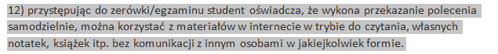
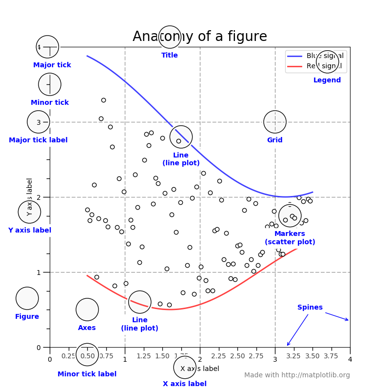

# wd-egz-cheat-sheet

An exam cheat sheet with Python chart examples in matplotlib and seaborn, and notes on pandas and NumPy.

University coursework from my Computer Science studies at UWM (2020–2024). I wrote the code by hand; the commit history is unchanged. This README was added in November 2026.

Years of work: 2021 (first commit on 12 June 2021, last commit on 13 June 2021).

## Contents

- `w/`: 11 scripts with chart types (stacked bars, lines, two Y axes, pie charts) and their PNG output.
- `plt/`: simple matplotlib charts and a pyplot cheat sheet image.
- `sns/`: simple seaborn charts.
- `notatki-2/`, `notatki-różne/`: notes as scripts (pandas, NumPy, matplotlib, seaborn).
- `podstawa.png`: the picture at the top of the original note.

## Running

The scripts need matplotlib, seaborn and pandas, which this machine does not have, so I did not run them in November 2026.

## Original note

# wd-egz-cheat-sheet
 
 
 ### LINKI  
 `matplotlib:`
 - [dokumentacja](https://matplotlib.org/stable/contents.html)
 - [przyklady](https://matplotlib.org/stable/gallery/index.html)
 - [usage guide](https://matplotlib.org/stable/tutorials/introductory/usage.html#sphx-glr-tutorials-introductory-usage-py)
 - [pyplot - fajne przyklady](https://matplotlib.org/stable/tutorials/introductory/pyplot.html#sphx-glr-tutorials-introductory-pyplot-py)
 
  
 
 `seaborn:`
 - [str. główna](https://seaborn.pydata.org/)
 - [tutorial](https://seaborn.pydata.org/tutorial.html)
 - [sns przyklady](https://stackabuse.com/seaborn-line-plot-tutorial-and-examples)
 - [sns wiecej przykladow](https://www.geeksforgeeks.org/python-seaborn-tutorial/)
 - [sns introduction(**przydatne**)](https://seaborn.pydata.org/introduction.html)
 - [sns w3](https://www.w3schools.com/python/numpy/numpy_random_seaborn.asp)
 
  
 
 `numpy:`
 - [dokumentacja](https://numpy.org/doc/stable/)
 
  
 
 ### [notatki - kolo2](https://github.com/maciejszulia/kolo2/tree/main/pythonProject7)
 ### [pr. dom](https://github.com/maciejszulia/python-uwm)
 ### [seaborn dla debili](https://www.datacamp.com/community/tutorials/seaborn-python-tutorial)
 ### [seaborn na szybko](https://s3.amazonaws.com/assets.datacamp.com/blog_assets/Python_Seaborn_Cheat_Sheet.pdf)
 ### [matplotlib na szybko](https://s3.amazonaws.com/assets.datacamp.com/blog_assets/Python_Matplotlib_Cheat_Sheet.pdf)
 
  
 
 ## pyplot cheat-sheet
 

## Po polsku

Repozytorium zawiera ściągę na egzamin z przykładami wykresów w Pythonie (matplotlib, seaborn) i notatkami o pandas i NumPy. Kod napisałem ręcznie na studiach informatycznych na UWM w 2021 roku.
